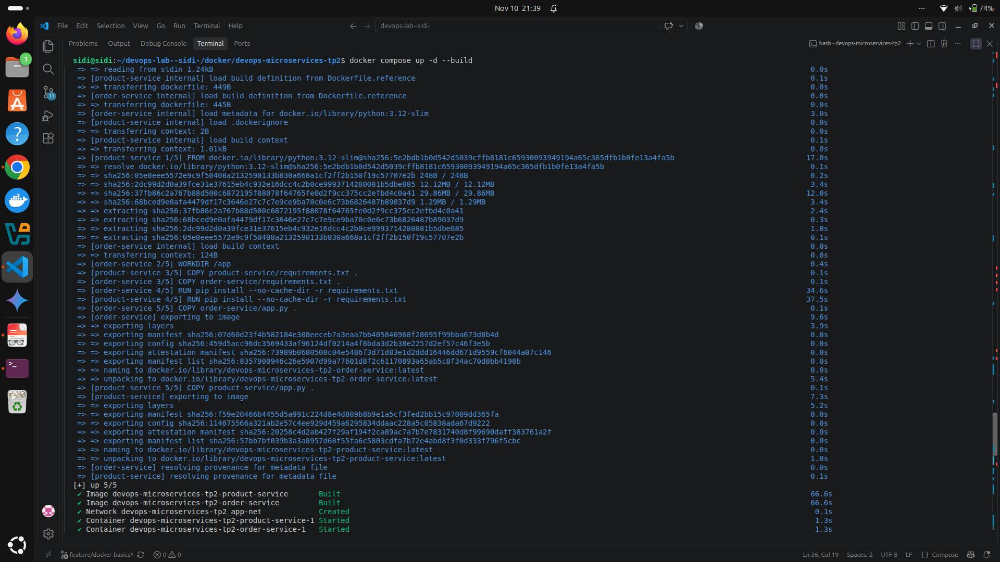
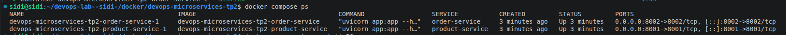
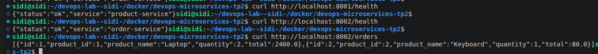
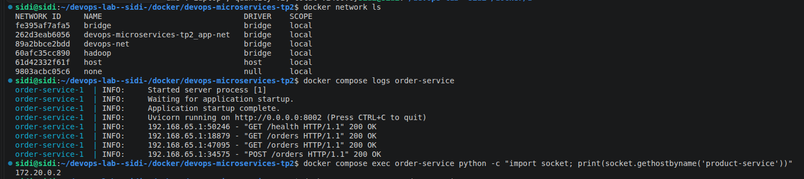
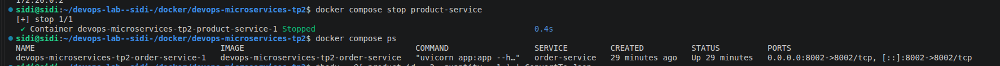
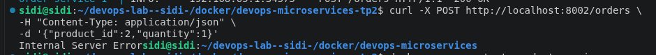
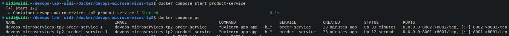
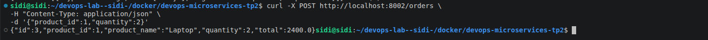

TP3 - Docker Compose

###
1. Docker Compose Configuration
The following Docker Compose file was used to deploy the Product Service and Order Service:

services:
  product-service:
    build:
      context: .
      dockerfile: product-service/Dockerfile.reference
    ports:
      - "8001:8001"
    networks:
      - app-net

  order-service:
    build:
      context: .
      dockerfile: order-service/Dockerfile.reference
    ports:
      - "8002:8002"
    environment:
      PRODUCT_SERVICE_URL: http://product-service:8001
    depends_on:
      - product-service
    networks:
      - app-net

networks:
  app-net:
    driver: bridge

 
###

2. Deployment
The application was deployed using:

docker compose up -d --build

###

3. API Verification
The following endpoints were tested successfully:

###

4. DNS Check
Docker Compose automatically provides internal DNS resolution. The hostname product-service was resolved from the order-service container through the shared network.

###

5. Failure Observation
After stopping product-service:

docker compose stop product-service

Order creation requests failed because the dependency was unavailable.

###

6. Recovery Observation
After restarting product-service:

docker compose start product-service

Order creation requests succeeded again.

###

7. Answers to Report Questions

Q1. Compare the default bridge network with a user-defined bridge.
The default bridge network provides basic container connectivity but does not automatically provide DNS-based service name resolution between containers. A user-defined bridge network provides automatic DNS resolution, better isolation, and easier service-to-service communication.

Q2. Explain service-name DNS and why Order Service uses http://product-service:8001.
Docker Compose provides an internal DNS server. Each service name becomes a hostname on the network. Order Service uses http://product-service:8001 because Docker automatically resolves product-service to the IP address of the Product Service container.

Q3. Explain services, build, ports, environment and networks in compose.yaml.
services: Defines the containers to run.
build: Specifies how to build the Docker image.
ports: Maps container ports to host ports.
environment: Defines environment variables used by the application.
networks: Defines the networks used for communication between containers.

Q4. Why is build context "." for these reference Dockerfiles?
The build context is . because the Dockerfiles need access to files located in the project root directory. Docker sends the entire project directory as the build context during image creation.

Q5. Compare docker compose up -d, stop and down. What does down remove?
docker compose up -d: Creates and starts containers in detached mode.
docker compose stop: Stops running containers but keeps them and the network.
docker compose down: Stops and removes containers and the Compose network.

Q6. What is the purpose and limitation of depends_on?
depends_on ensures that dependent containers start in the correct order. However, it does not guarantee that a service is fully initialized and ready to accept requests.

Q7. What happened when Product Service stopped, and why could Order Service remain running?
When Product Service was stopped, requests that required product information failed. Order Service remained running because it is an independent container, but it could no longer communicate with Product Service.

Q8. How can you verify container DNS and inspect the Compose network?
Container DNS can be verified using commands such as:

docker compose exec order-service ping product-service

###
